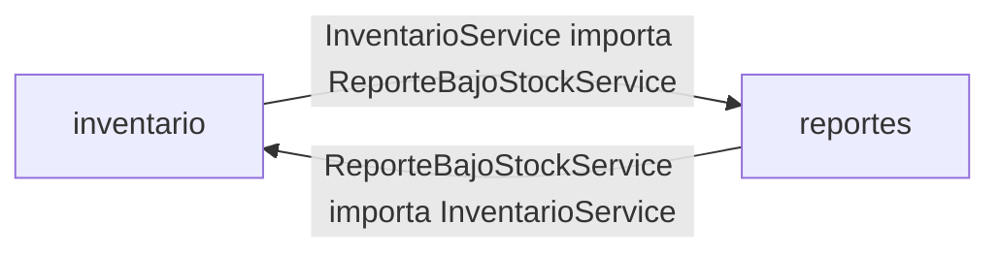
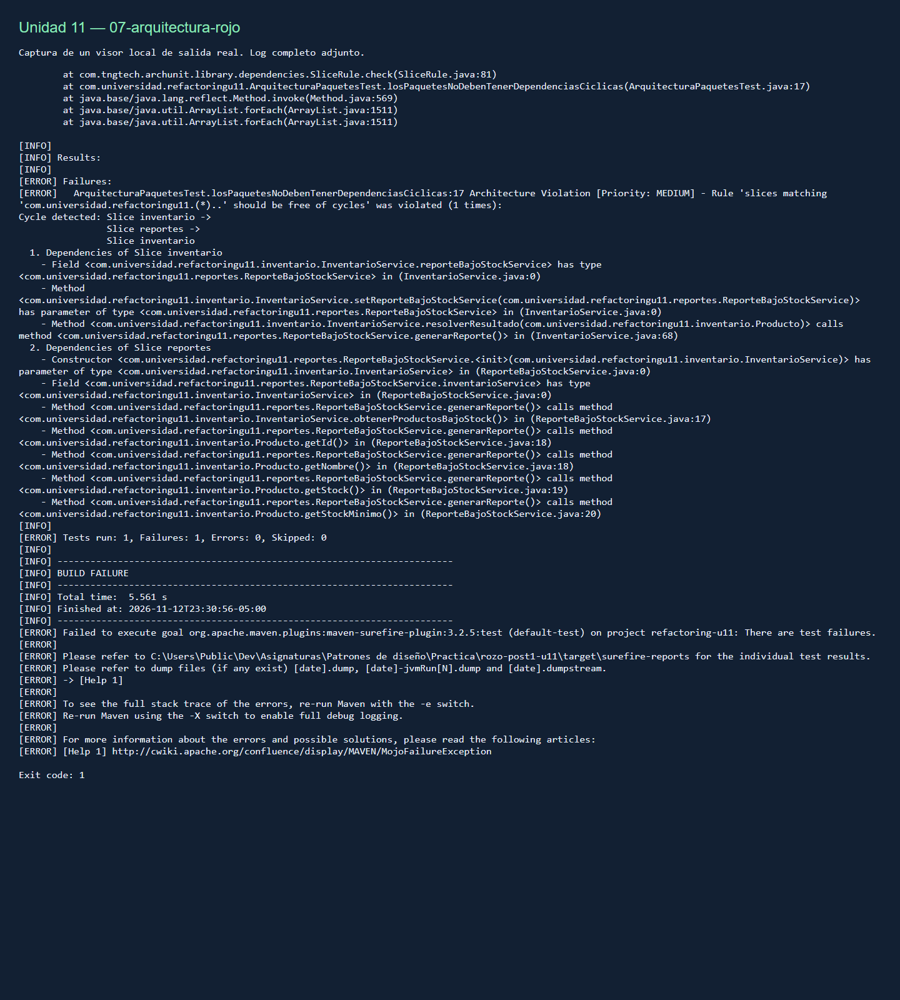
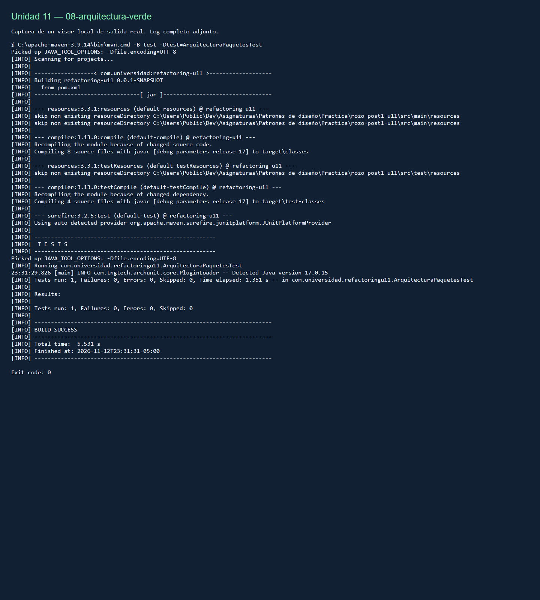

# Refactorización guiada por pruebas — Unidad 11

**Jhoseth Esneider Rozo Carrillo · Patrones de Diseño de Software · UDES**

Proyecto Maven único en la raíz: `com.universidad:refactoring-u11`, Java 17, JAR.
Spring Boot Starter y Starter Test; sin Web, persistencia ni endpoints.

## Parte 1 — Decisiones de diseño

### 1. Extract Function (Extract Method) para el Long Method

`actualizarInventario` orquesta validación, búsqueda, cálculo/actualización del stock,
registro y resultado. Cada función extraída expresa una intención reconocible.
El cálculo de reorden queda en el método privado `calcularCantidadReorden`: es una
fórmula simple y estable (`stockMinimo * 3 - stock`), sin estado ni colaboradores.
Una clase independiente agregaría indirección sin aportar una razón de cambio actual.
Si aparecieran políticas por proveedor, plazos o demanda, extraería una
`CalculadoraReorden` con pruebas propias. No se cambia la validación original.

### 2. Replace Conditional with Polymorphism para el switch duplicado

Se elige un enum con métodos abstractos implementados por cada constante.
El conjunto es cerrado y estable: el compilador exige ambos comportamientos al
agregar un tipo. `ClasificadorProducto` y `EtiquetadoProducto` conservan sus firmas
y delegan; ninguno necesita cambiar para admitir otra constante.
Una interfaz de estrategia con una clase por tipo sería preferible si los tipos
necesitaran colaboradores inyectados por Spring; las constantes enum no son beans
y esa inyección complicaría el diseño actual. Hoy el enum evita esa jerarquía adicional.

## Ejecución y evidencia de la Parte 1

Requisitos: JDK 17+ y Maven 3.9+. Ejecutar desde la raíz:

```sh
mvn clean test
mvn package
java -jar target/refactoring-u11-0.0.1-SNAPSHOT.jar
```

No hay servidor HTTP: la aplicación inicia el contexto y termina. Las pruebas de
caracterización usan `new InventarioService()`, sin levantar Spring.

| Métrica | Original (`p1-original`) | Refactorizado |
|---|---:|---:|
| Líneas físicas del método, firma y cierre incluidos | 44 | 10 |
| Complejidad ciclomática local de ese método | 12 | 5 |
| Responsabilidades mezcladas en un bloque | 6 | Orquestación; operaciones delegadas |
| Switches sobre TipoProducto | 2 | 0 |
| Ramas de tipo repetidas estructuralmente | 4/4 (100%) | 0/4 (0%) |

Las seis responsabilidades eran validación, búsqueda, stock, cálculo de reorden,
auditoría y alerta. El porcentaje anterior mide coincidencia de las cuatro ramas
en los dos switches, **no** porcentaje de líneas duplicadas del repositorio.
La CC se calcula como `1 + if + for + while + case + && + || + ?` sobre el método,
excluyendo comentarios. Es una métrica local: las decisiones extraídas no desaparecen
del sistema. `scripts/checkpoints.py` permite reproducir conteos y hashes.

| Checkpoint | Resultado real | Evidencia (log y captura PNG del mismo nombre) |
|---|---|---|
| Original | Compila, aún con ambos smells | [01-original](docs/evidencias/01-original.log) |
| Caracterización antes del refactor | 25 pruebas, 0 fallos | [02-caracterizacion](docs/evidencias/02-caracterizacion.log) |
| Cada extracción, en orden 1–5 | 25 pruebas, 0 fallos en cada una | [Extracción 1](docs/evidencias/03-extraccion-1.log), [2](docs/evidencias/03-extraccion-2.log), [3](docs/evidencias/03-extraccion-3.log), [4](docs/evidencias/03-extraccion-4.log), [5](docs/evidencias/03-extraccion-5.log) |
| Polimorfismo | Las mismas 25 pruebas, 0 fallos | [04-polimorfismo](docs/evidencias/04-polimorfismo.log) |
| Estructura, hashes e historial | Método ≤10 líneas; switches eliminados; pruebas inmutables | [05-checkpoints-parte1](docs/evidencias/05-checkpoints-parte1.log) |

Las 25 pruebas son 15 de inventario, 5 de recargo y 5 de etiqueta: incluyen las
cuatro ramas en **ambas** clases, entradas inválidas, producto inexistente,
stock insuficiente, umbral exacto, stock cero, cantidades negativas y nulos,
y el texto exacto de auditoría/alerta. Se conservan incluso los comportamientos
extraños del original. Agregar validaciones sería otro cambio funcional.
El enunciado ilustra dos etiquetas y un total de 12, pero exige las cuatro ramas:
la suite amplía esos ejemplos desde el comienzo. Menciona también «cuatro pruebas
de caracterización», aunque nombra tres clases; aquí se conservan las tres completas.

Las capturas son fotografías de un visor HTML local que muestra logs reales;
no son capturas de un IDE ni resultados simulados. Los logs completos quedan
versionados junto a cada PNG; `scripts/verificar.py` ejecuta y captura comandos.

## Parte 2 — Diagnóstico del acoplamiento

Antes de corregirlo (`p2-ciclo`), compila y las 25 pruebas de negocio pasan;
el guard del colaborador opcional conserva el uso directo sin Spring.
La prueba `ArquitecturaPaquetesTest` detecta el ciclo entre paquetes:



El error de diseño no es un fallo funcional: dos paquetes se conocen mutuamente.
Se conserva un commit explícitamente en rojo como evidencia previa a la solución.

La ejecución real de `mvn test -Dtest=ArquitecturaPaquetesTest` produjo:

```text
Cycle detected: Slice inventario ->
                Slice reportes ->
                Slice inventario
Tests run: 1, Failures: 1, Errors: 0, Skipped: 0
BUILD FAILURE
```

Evidencia: [negocio verde con el ciclo](docs/evidencias/06-reportes-con-ciclo.log),
[ArchUnit en rojo](docs/evidencias/07-arquitectura-rojo.log) y
[captura del ciclo](docs/evidencias/07-arquitectura-rojo.png).

## Parte 2 — Solución y decisiones

### 3. Interfaz en el dominio e inversión de dependencias

`inventario` es el paquete de mayor nivel: define las reglas de stock y el evento
que necesita comunicar. `reportes` materializa una salida de ese evento. Por eso
`NotificadorBajoStock` pertenece a `inventario`: «los paquetes de infraestructura
dependen de dominio; dominio nunca depende de infraestructura».
Colocarla en `reportes` mantendría la dependencia del dominio hacia infraestructura.
El servicio conoce solo el contrato; el reporte lo implementa y consulta inventario.


Dentro del dominio, `InventarioService` usa `NotificadorBajoStock` y `Producto`.
No hay ningún import de `reportes` dentro de `inventario`.
La interfaz rompe el **ciclo de paquetes**; las instancias aún se relacionan en ambos
sentidos. Se usa `@Lazy` en el parámetro del setter para que Spring inyecte un proxy
del contrato y resuelva el colaborador al notificar. Así arranca con las referencias
circulares deshabilitadas por defecto, sin habilitar `allow-circular-references`.
El constructor sin argumentos y el colaborador opcional conservan la caracterización.

### 4. Notificación por evento individual

`notificar(Producto, int cantidadReorden)` expresa la transición que acaba de ocurrir:
conserva la cantidad calculada para ese instante, evita volver a recorrer todo el
inventario y permite registrar inmediatamente cada alerta. El reporte guarda texto
como instantánea para que un cambio posterior de stock no reescriba la alerta.
Un lote sería preferible en una reconciliación nocturna o para reducir llamadas a
un proveedor externo con límites o costos por petición. En ese caso definiría
eventos inmutables con sus cantidades y una operación de envío masivo.

`generarReporte()` lista el stock actualmente inferior al mínimo y las alertas
registradas desde el arranque. No vacía el historial al leerlo. Se excluye el stock
igual al mínimo y se conserva el orden de inserción. Los datos son en memoria,
acorde con el laboratorio; no se añade persistencia.

## Verificación consolidada y entregables

Después de DIP, **sin cambiar la prueba de arquitectura**:

```text
Tests run: 1, Failures: 0, Errors: 0, Skipped: 0
BUILD SUCCESS
```

Ver [ArchUnit en verde](docs/evidencias/08-arquitectura-verde.log) y su
[captura](docs/evidencias/08-arquitectura-verde.png).
La suite final `mvn clean verify` recompila, ejecuta y empaqueta:

```text
Tests run: 30, Failures: 0, Errors: 0, Skipped: 0
BUILD SUCCESS
```

Son las **25 pruebas originales intactas**, 1 de arquitectura, 3 de reportes y 1 de
integración Spring. Las adicionales comprueban notificación efectiva, reporte vacío,
umbral, alerta histórica y arranque real. Ver [log final](docs/evidencias/09-suite-final.log)
y [captura final](docs/evidencias/09-suite-final.png).
La [auditoría final de checkpoints](docs/evidencias/10-checkpoints-final.log)
([captura](docs/evidencias/10-checkpoints-final.png)) comprueba las 10 líneas, la
eliminación de switches, los hashes originales y la dirección de dependencias.
El [JAR también se ejecutó correctamente](docs/evidencias/11-arranque-jar.log)
([captura](docs/evidencias/11-arranque-jar.png)), con salida 0.




| Requisito / rúbrica | Comprobación |
|---|---|
| Implementación (40%) | Extract Method, polimorfismo enum, interfaz de dominio y ArchUnit sin ciclos |
| Funcionalidad (25%) | 25 pruebas antes de tocar producción; 5 extracciones verdes; rojo/verde arquitectónico; 30 finales |
| Documentación (20%) | Métricas reproducibles, logs y PNG, dos diagramas y cuatro decisiones justificadas |
| Estilo (15%) | Nombres Java, firmas públicas originales, cero switch/if por tipo y cero import de reportes en dominio |
| Proyecto único | `pom.xml` y `src/` directamente en la raíz; Java 17; JAR; sin Web ni Data |
| Historial por partes | Etiquetas `p1-original`, `p1-caracterizacion`, `p1-extract-method`, `p1-polimorfismo`, `p1-completa`, `p2-ciclo`, `p2-arquitectura-rojo`, `p2-dip` |
| Capturas de checkpoints | PNG y log por paso en [docs/evidencias](docs/evidencias), incluidos cada extracción y el fallo intencional |
| Entrega | [Repositorio público rozo-post1-u11](https://github.com/JhosethRozo/rozo-post1-u11) |

Para revisar el rojo de forma aislada, crear otro clon y seleccionar
`git checkout p2-arquitectura-rojo`; allí las pruebas de negocio pasan y ArchUnit
falla intencionalmente. Volver a `main` para evaluar el estado final.
`git diff p1-caracterizacion -- src/test/java/com/universidad/refactoringu11/inventario/`
no debe producir salida. `python scripts/checkpoints.py` verifica además los SHA-256.

Las validaciones locales usaron Maven 3.9.14 y JDK 17.0.15. En este equipo Windows,
el directorio temporal del usuario contiene `&`: antes de ejecutar Maven se asignó
`TEMP` y `TMP` a `.tmp` dentro del proyecto para evitar que el shell de Surefire
cortara el argumento. No es necesario en sistemas con rutas temporales normales.
Los scripts de captura requieren Python 3 y Chrome; no son necesarios para compilar.
GitHub Actions vuelve a comprobar todo con Java 17 en Linux.
La [ejecución externa de la entrega](https://github.com/JhosethRozo/rozo-post1-u11/actions/runs/43366383048)
terminó en **success**, incluidas las 30 pruebas y la auditoría de checkpoints.
Se adjuntan [log](docs/evidencias/12-github-actions.log) y
[captura de la consulta real a GitHub](docs/evidencias/12-github-actions.png).

El nombre exigido por la actividad es `rozo-post1-u11`: se usa ese repositorio público
existente, integrando su commit inicial y ampliando su `.gitignore`. La entrega `u10`
se conserva. El proyecto usa la configuración Maven/Spring Boot indicada por el
enunciado; el esqueleto se creó localmente, sin atribuirle una generación web.
Para entregar, copiar el enlace de `u11` en el Aula virtual UDES antes del plazo.
